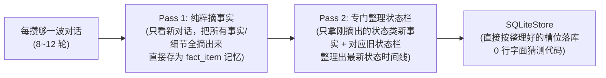
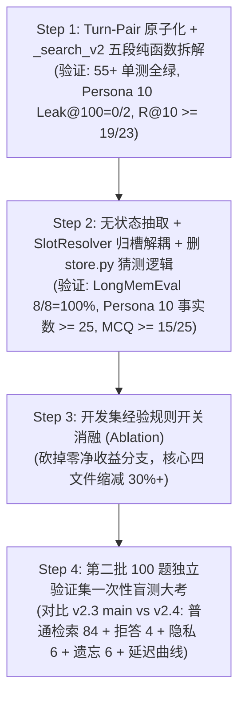

# Dandelion Memory v3 架构演进与解耦设计方案（v2.4 ~ v3.1）

> **版本定位**：基于 `main`（`374be13`）实测归因、[complexity-review.md](file:///home/maomao/dandelion-memory-batch2-20261026/docs/reports/2026-10-26/complexity-review.md) 复杂度诊断，以及 **砚（4a）**、**烬（Codex `gpt-6-astra`）**、**DeepSeek（`deepseek-v4.1-flash`）** 三方会诊结论制定。核心目标是**消除跨层重复猜测、解耦抽取与归槽、统一问答对原子粒度、用消融实验给代码做减法**。

---

## 一、设计目标与四大架构不变量

### 1.1 量化收敛目标

| 维度 | 当前 `main` (`374be13`) | **v2.4 目标** | 核心手段 |
| :--- | :---: | :---: | :--- |
| **LongMemEval `knowledge-update` (8 题)** | **8/8 (100.0%)** | **8/8 (100.0%)** | 保留 `#F` 多值子槽 + Rank #2 `【状态时间线】` 聚合卡 |
| **PersonaMem 50 题 `ask_to_forget` 零泄漏** | **50/50 (100.0%)** | **50/50 (100.0%)** | 保留显式遗忘硬门控 + 切片级 `[已擦除]` |
| **Persona 10 `Forget Leak@100` (2 题)** | 1/2（放开 AI 邻居后漏出复述） | **0/2 (零泄漏)** | `turn_pair_id` 问答对遗忘级联 + 装箱前终审守门 |
| **Persona 10 活跃 `fact_item` 数 (161 轮)** | 22 条 | **>= 25 条**（对齐 v2.2 的 26 条） | 取消向 Prompt 注入历史账本，恢复无状态高密度抽取 |
| **Persona 10 检索 `R@10` / 端到端 MCQ** | 18/23 (78.3%) / 12/25 (48.0%) | **>= 19/23 (82.6%) / >= 15/25 (60.0%)** | `Turn-Pair` 合并释放 Top-10 重复坑位 + 抽取密度恢复 |
| **静态复杂度（核心四文件）** | 4,888 行（`_search_v2` 833 行） | **缩减 30%+**（`_search_v2` < 250 行） | 删净 `store.py` 猜槽分支，`_search_v2` 拆为 5 个纯函数 |

### 1.2 四大架构不变量（Invariants）

> [!IMPORTANT]
> 1. **INV-1（更新 ≠ 销毁）**：只有包含显式遗忘意图（`has_explicit_forget_keyword`）的指令才能将 `fact_item` 或 `raw_slice` 标为 `tombstoned = 1`。状态演进（Supersede）只更新 `tag_timelines` 并通过置顶的 `【状态时间线】` 卡片呈现，**永不墓碑历史 `fact_item`、永不涂改原始母消息正文**。
> 2. **INV-2（摘取与状态栏整理拆成两次独立调用）**：第一次调用（Pass 1）只看新对话、无状态高密度摘取原子事实（不塞旧状态表，确保日常细节不漏）；第二次调用（Pass 2）仅针对抽出的新事实，结合相关类目的旧状态栏做一次专门的状态整理更新。彻底删掉 `store.py` 里靠字面重叠猜槽位的 180 行规则。
> 3. **INV-3（有边界的 Turn-Pair 问答绑定）**：仅在同一会话内紧挨着的短问答（`user #m -> assistant #m+1`）之间绑定 `turn_pair_id`；跨会话、连续用户发言、超长文档切片或 `assistant_draft` 草稿绝不强行合卡；显式遗忘只按 `user (#m) -> assistant (#m+1)` 单向连带遮蔽 AI 的复述。
> 4. **INV-4（身份单次解释 + 检索纯函数链）**：人物归属（`subject` / `source_tier`）只在写入边界解释一次，检索期只读结构化字段；`_search_v2` 拆解为无共享可变字典的 5 段纯函数链，并在预算装箱前执行最终遗忘防漏检查。

---

## 二、模块一：两步式独立调用（Pass 1 只管摘事实 + Pass 2 专门整理状态栏）

### 2.1 病根与两步拆分设计

在 v2.3 中，为了省一次调用，把历史状态表 `[#F1..#Fn]` 全塞进同一个 Prompt，让 `qwen3.5-flash` 一边摘日常细节、一边算状态增删改（`set/add/delete`）。结果小模型顾此失彼（Persona 10 提取量从 26 条掉到 22 条，还把日常新进展误判成覆盖旧状态）；同时逼着 [store.py](file:///home/maomao/dandelion-memory/src/dandelion_memory/store.py) 写了 180 多行靠字面重叠猜槽位的笨规则。

v2.4 直接把“摘事实”和“更状态栏”拆成**两次清爽、职责单一的模型调用**：



### 2.2 Pass 1：纯粹摘取事实（只管摘，不看旧账）

Pass 1 的 Prompt 完全不塞历史状态表，只看这几轮对话，把所有事实细节和明确遗忘指令摘出来，全部直接存为独立的 `fact_item`（谁也不覆盖谁）：

```json
{
  "facts": [
    {
      "seq": 2,
      "subject": "user",
      "tag": "资产/物品与车辆",
      "value": "拥有 Wells Fargo 提供的 $400,000 房贷预批额度",
      "is_state_candidate": true,
      "source_tier": "user_direct"
    }
  ],
  "forget_actions": [
    {
      "trigger_seq": 15,
      "target_keywords": ["银行卡", "6688"],
      "target_description": "尾号 6688 的银行卡",
      "batch_seqs_to_tombstone": [12, 15]
    }
  ]
}
```

### 2.3 Pass 2：每 20 轮问答（40 条消息）专门总结/更新一次状态栏

把状态栏更新固定为**每 20 轮一问一答（40 条消息，约攒下 3~4 批摘取、6~10 条新事实）触发一次**（若对话结束或发起检索时还有未汇总的新事实，则顺手刷一次兜底）：
- **输入**：只给模型看【这 20 轮里新摘出的事实】+【数据库里同标签下的旧状态栏 `#F1, #F2...`】；
- **任务**：专门判断这些新事实是“更新了某个旧状态槽位（比如搬家、换工作、藏品数量增加）”，还是“新增了一项并列资产/状态（新开 `#Fn`）”，还是“普通日常细节不用进状态栏”；
- **收益**：
  1. Pass 1（每 6 轮问答一次）不受旧状态干扰，日常细节一条不漏；
  2. Pass 2（每 20 轮问答一次）只对比短短几条提炼好的句子，跨十几轮的连续变化也能放在一起看清，80 轮长对话全程只需调 4 次；
  3. [store.py](file:///home/maomao/dandelion-memory/src/dandelion_memory/store.py) 里那 **180 多行靠词面重叠率猜槽位的脏代码全部删光**。

---

## 三、模块二：有边界的 `turn_pair_id` 问答对绑定

### 3.1 什么时候绑、什么时候绝不绑？

把“用户说一句 + AI 回一句”绑成一对（`turn_pair_id`），只针对**同一会话里紧挨着的常规一问一答**。以下 4 种情况**绝不硬绑**：

1. **跨会话或非一问一答不绑**：
   - 用户连发多条消息（`user -> user`）、双人聊天（如 LoCoMo）、或者跨了不同 `session_id` 时，每条消息各自独立，不绑在一起。
2. **超长回复 / 长文档切片不合卡**：
   - 当用户贴了长文或 AI 输出了长篇方案/故事（被切成了多段 `raw_slice`，或单条超过 `1000` 字）时，检索时不把整篇长文和提问硬塞进同一张大卡片，避免一张卡吃光字数预算。
3. **AI 拟稿（`assistant_draft`）不与用户事实混绑**：
   - 当 AI 只是在帮用户写信、润色文案（`source_tier == "assistant_draft"`）时，不跟用户的个人真实经历混成同级卡片。
4. **遗忘连带只走“用户 -> AI”单向**：
   - 只有当用户在 `#m` 说了某件隐私事（后要求忘掉），才顺带遮蔽紧接着回答他的 `AI 回复 #m+1`（防止 AI 顺嘴复述的半句漏底）；反过来绝不会因为删某句 AI 的话而连坐删掉前后用户的正常提问。

### 3.2 检索期：合格短问答合为一张卡（省下 Top-10 坑位）

对满足绑定条件的常规短问答（如 Persona 10 里的 `#40 user` 和 `#41 assistant`）：
- 当两条都被检索召回或互为配对上下文时，合并为**唯一一张 `TurnPairCard`**（`rrf_norm = max(rrf_user, rrf_assistant)`），按顺序展示 `[#m | user] ... \n [#m+1 | assistant] ...`；
- 同一个回合在 Top-10 里只占 **1 个名额**，不再成双成对挤走排名第 10 的关键证据。

### 3.3 遗忘期：单向连带遮蔽 AI 复述（封死 `Leak@100 = 0/2`）

1. **写入遗忘连带**：在 [store.py](file:///home/maomao/dandelion-memory/src/dandelion_memory/store.py) 的 `execute_forget_action` 中，当用户消息 `#m` 被判定为需要遗忘时，自动检查同一问答对的 `AI 回复 #m+1`：对其中包含遗忘关键词的句子打上 `[已擦除]`，若 `#m` 整条被删，则禁止 `#m+1` 作为邻居被别的卡片顺带捞出。
2. **装箱前终审**：在检索结果打包输出前，统一拦截任何已被标记遗忘的问答对残余片段。

---

## 四、模块三：`_search_v2` 的 5 段正交纯函数拆解与减法清单

### 4.1 拆解 833 行的 `_search_v2`（[pipeline.py](file:///home/maomao/dandelion-memory/src/dandelion_memory/pipeline.py)）

将 `_search_v2` 重构为 5 个输入输出显式类型化的正交函数，主控函数控制在 **60 行以内**，总检索代码控制在 **250 行以内**：

| 阶段函数 | 输入 | 输出 | 单一职责 |
| :--- | :--- | :--- | :--- |
| **1. `recall_raw_and_facts`** | `SearchRequest`, `query_vec` | `RecalledPool` | 执行 Vector + BM25 + Time 三路召回，计算基础 `rrf_norm` |
| **2. `pull_timeline_evidence`** | `RecalledPool`, `timeline_pull_map` | `RecalledPool` | 顺着高分 `timeline_summary` 的 `latest_seq` 拉取对应原话切片 |
| **3. `build_turn_pair_cards`** | `RecalledPool`, `store` | `list[TurnPairCard]` | 按 `(turn_pair_id, source_tier, subject)` 聚合并组装问答卡与提炼事实 |
| **4. `score_and_rerank_cards`** | `pure_query`, `list[TurnPairCard]` | `list[ScoredCard]` | 调用 `qwen3-rerank` 计算线性融合分与结构化 `subject` 匹配门控 |
| **5. `pack_with_forget_guard`** | `list[ScoredCard]`, `top_k`, `budget` | `list[SearchItem]` | Rank #2 置顶合格 `timeline_summary`、执行 Token 预算装箱与遗忘终审 |

### 4.2 复杂度减法清单（Direct Removal vs. Ablation）

1. **直接删除的冗余分支**：
   - 删除 [store.py](file:///home/maomao/dandelion-memory/src/dandelion_memory/store.py) 中 `upsert_tag_timeline` 的 180+ 行类目前缀表、词面重叠猜测与动态 DF 停用词逻辑；
   - 删除 [pipeline.py](file:///home/maomao/dandelion-memory/src/dandelion_memory/pipeline.py) 中 `_is_subj_in_query` 的亲属词单字猜测分支，改为直接匹配入库时的结构化 `subject`；
   - 删除 `_search_v2` 中散落的 `long_doc_slice_counts`、`emitted_seqs` 跨卡剥离及 `[⚠️ 状态已更新]` 拼接代码。
2. **在开发集上做开关消融（Ablation）的经验参数**：
   - `Index-to-Raw Pull` 阈值（`tl_rrf >= 0.35`, 权重 `0.85`）；
   - `time_bonus (+0.10)` 与 `latest_bonus (+0.05)`；
   - `D_direct / D_draft` 的固定回填配额分支（对比直接按分数排序是否等价或更优）。

---

## 五、四步执行与验证路线（严守第二批 100 题盲测边界）

> [!WARNING]
> **防过拟合铁律（采纳 Codex `gpt-6-astra` 建议）**：`3c1407b` 采集的**第二批 100 题独立验证集**（LongMemEval-S 40 题 + PersonaMem-v2 30 题 + LoCoMo 30 题）严禁在 Step 1~3 的开发和规则消融中偷看调参，必须留到 **Step 4** 作为一次性盲测验收！



---

## 六、v2.4.1 增量修正：一号总结模型状态融合与合槽同步（Blast Radius 隔离设计）

### 6.1 问题归因

在 v2.4 人物状态 Map 与 `slot_id` 唯一主键重构后，第一批小验证集复测显示：
- **Persona 10**：`R@10 = 22/23 (95.7%)`，`Forget Leak@100 = 0/2`，`MCQ = 19/25 (76.0%)`（他人归属混淆从 6 题降至 0 题）；
- **LongMemEval `knowledge-update` (8 题)**：从 `8/8 (100%)` 降至 `5/8 (62.5%)`（失败题：`da6234e4` 慈善 5K PB 隐式刷新、`b6036f5d` 房贷预批额度变更、`885f10d3` 自行车数量从 3 辆增至 4 辆）。

逐题排查确认，掉分完全是因为在精简代码和切换 `slot_id` 时**误删或漏接了原本在一号总结模型与状态栏同步链路上的 3 项功能**：
1. **`_STATE_SUMMARY_PROMPT` 缺少「前后状态融合与隐式刷新」指令**：Pass 1 精简 Prompt 时移除了隐式状态刷新说明，但一号总结模型（`_STATE_SUMMARY_PROMPT`）只要求输出 `latest_state`，未要求将 `older_fid` 的背景实体/旧基准值与 `newer_fid` 的新进展融合为完整结论句，导致总结模型直接照抄后半句半截原话（如丢了 `charity 5K run` 主语、漏了 `27:12 -> 25:50` 的旧值对照）。
2. **`merge_timeline_slots` 合槽后未将融合后的 `latest_state` 同步回存活槽位的 `fact_item`**：`store.py:1551-1570` 合槽时只更新了 `timeline_summary` 卡片，而存活槽位 `surviving_slot_id` 关联的 `fact_item` 仍停留在未融合的半截原话，导致原始对话卡下方的 `[提炼事实: ...]` 与状态栏不一致。
3. **`get_latest_tag_map` 与 `get_superseded_seqs_map` 漏接细粒度 `slot_id`**：
   - `store.py:2583` 的 `get_latest_tag_map` 仍按粗粒度 `(subject, tag)` 18 个大类互相覆盖（例如同属 `兴趣/运动与休闲活动` 的后续网球比赛对话，把前面慈善 5K 跑步与自行车数量的 `is_latest_in_tag` 顶掉了）；
   - `store.py:2600` 已写好的 `get_superseded_seqs_map(user_id)` 在 `_build_turn_pair_cards` 拆分时被误删调用，导致已被合槽取代的旧对话卡（如 `#3` 旧额度 `$350,000`、`#2` 旧数量 `3 bikes`）缺少 `[状态更新提示: 已于后续 #seq 更新为 ...]` 标注和 `is_superseded` 标记。

### 6.2 修改边界（Blast Radius 隔离契约）

为确保绝不影响已跑通的 Persona 10（`22/23` 召回、`0/2` 遗忘、`19/25` MCQ）及二号认人模型，本次修改严格锁死在以下窄链路内：

| 类别 | 模块 / 函数 | 边界约束 |
| :--- | :--- | :--- |
| **唯一允许修改（In-Scope）** | 1. `extractor.py:26-46` `_STATE_SUMMARY_PROMPT`<br>2. `store.py:1551-1575` `merge_timeline_slots`<br>3. `store.py:2583-2626` `get_latest_tag_map` / `get_superseded_seqs_map`<br>4. `pipeline.py:1305-1706` `_build_turn_pair_cards` 内部状态栏同步与 `is_superseded` 传递 | 仅修改一号总结模型的融合 Prompt、合槽后存活槽位文本同步、以及基于活跃 `slot_id` / `superseded_seqs` 的状态标记。 |
| **严禁触碰（Out-of-Scope）** | - Pass 1 提取器 `_SYSTEM_PROMPT` 与 `extract()`（不破坏提取缓存与密度）<br>- 二号人物消歧模型 `_PERSON_RECONCILE_PROMPT` 与 `apply_person_map_updates()`<br>- 人物门控 `_is_subj_in_query` 与非本人状态卡 `0.35` 降权<br>- `restored_parent` 单卡动态归属头部与 `turn_pair` 组装<br>- 显式遗忘 `execute_forget_action()` 与 Rerank/Pack 分桶 | **以上模块一行代码不改**。 |

### 6.3 精确增量方案

#### 改动点 1：一号总结模型（`_STATE_SUMMARY_PROMPT`）强化「前后状态融合与隐式刷新」
- **输入输出 Schema 不变**：输入仍为同一人物按时间排列的活跃槽位 `[F1] ... [Fn]`，输出仍为 `{"merges": [{"older_fid": "...", "newer_fid": "...", "latest_state": "..."}]}`。
- **Prompt 规则补齐**：
  1. **隐式状态刷新识别**：当 `older_fid` 记录了某项指标的旧纪录/旧数量/旧额度（如 5K PB 为 `27:12`、拥有 `3 bikes`、房贷预批 `$350,000`），而 `newer_fid` 提到该指标已处于新基准（如“正在训练以打破 `25:50` 的 PB”、“带齐全部 `4 bikes` 含新买的 gravel bike”、“拿到 `$400,000` 预批”），必须判定为同一事项的状态更新并合并。
  2. **前后信息完整融合（禁止半截照抄）**：`latest_state` 严禁只复制 `newer_fid` 的片断！必须将 `older_fid` 中的完整背景主语（如赛事名称 `charity 5K run`、银行名称、原有型号明细）与 `newer_fid` 的最新数值融合成一句完整、自洽的最新结论，并显式括号注明旧值演进（如 `"Current personal best time in the charity 5K run is 25:50 (updated from previous PB of 27:12), currently training to beat 25:50"`；`"Currently owns 4 bikes in total (updated from 3 bikes after adding a new gravel bike)"`）。

#### 改动点 2：`merge_timeline_slots` 同步更新存活槽位的 `fact_item`
- 在 `store.py:1551-1572` 执行合槽（`tombstone_slot_id -> surviving_slot_id`）时：
  - 除更新 `kind = 'timeline_summary'` 的 `display_text / search_text / bm25_tokens` 外；
  - 同步将 `surviving_slot_id` 对应的存活 `fact_item`（`WHERE user_id = ? AND kind = 'fact_item' AND (slot_id = ? OR chunk_id = ?) AND tombstoned = 0`）的 `display_text` 更新为融合后的 `resolved_current_state`（若 `surviving_subj.casefold() != "user"`，保持 `【非User本人，系{surviving_subj}的信息】` 前缀与 `[{surviving_subj} | {newer_row['tag']}]` 检索格式一致），并重算其 `search_text` 与 `bm25_tokens`；
  - **严守 `INV-1`**：被合槽取代的 `tombstone_slot_id` 仅墓碑其 `timeline_summary`，其历史 `fact_item` 保持 `tombstoned = 0` 不变（不销毁历史事实，也不涂改母消息 `parent_messages.content`）。

#### 改动点 3：检索卡片组装层恢复细粒度最新判定与旧槽 `[状态更新提示]`
- **细粒度最新轮次判定**：
  - 在 `store.py` 新增 `get_active_slot_latest_seqs(user_id) -> set[tuple[str, int]]`，返回所有活跃槽位（`tombstoned = 0`）的 `(subject_casefold, latest_seq)` 集合；
  - 在 `_build_turn_pair_cards` 中，只要某轮对话 `(subj.casefold(), p_seq)` 属于任一活跃槽位的 `latest_seq`，即具备 `has_active_latest_slot = True`，彻底消除同 `tag` 下不同事项互相覆盖 `latest_seq` 的问题。
- **被合槽取代的旧对话卡追加 `[状态更新提示]`（含同轮混合事实保护）**：
  - 在 `_build_turn_pair_cards` 中调用 `superseded_map = self.store.get_superseded_seqs_map(user_id)`；
  - 当 `group_tier == "user_direct"` 且 `(subj.casefold(), p_seq)` 命中 `superseded_map`（即该轮对话中包含已被一号总结模型明确合槽覆写的旧状态）时：
    1. 在该张对话卡末尾追加去重后的更新提示：`[状态更新提示: 本段提及的旧状态已于后续 #{l_seq} 更新为: {curr_st}]`；
    2. **同轮多事实保护（采纳评审意见）**：仅当该轮不存在任何其它仍处于 `latest_seq` 的活跃槽位（`not has_active_latest_slot`）时，才将 `is_latest_in_tag` 设为 `False` 并标记 `metadata["is_superseded"] = True`（并在 `existing is not None` 聚合分支中保持该标记不被覆盖）；若同轮还包含另一条未过期的独立最新槽位，则保留 `is_latest_in_tag = True`。
  - **零误伤保障**：未发生合槽覆写的绝大多数普通对话卡（如 Persona 10 中未合并的独立日常事实）完全不触发 `superseded_map`，卡片内容、分数与排序一字不变。


---

## 七、v2.4.1 七路消融与第二批 100 题盲测归档 & v3 演进起点

### 7.1 v2.4.1 七路消融实验结果（7-Way Ablation Matrix）

基于 `AblatablePipeline` 在 `Persona 10`（23 题常规检索 + 2 题遗忘控制）与 `LongMemEval Knowledge-Update`（8 题跨期状态更新）上的实测对比：

| 消融组 | 配置说明 | Persona10 R@10 | Persona10 R@20 | Persona10 R@100 | Persona10 MCQ (总 / 常规 / 遗忘 / 泄露) | LME Knowledge-Update (QA) |
| :--- | :--- | :---: | :---: | :---: | :---: | :---: |
| **A0: v2.4.1 Full** | **完整 v2.4.1 架构** | **21/23 (91.3%)** | **22/23 (95.7%)** | **23/23 (100%)** | 12/25 (48.0%) `[N=11/23, F=1/2, Leak=0/2]` | **8/8 (100.0%)** |
| **A1: - Index-to-Raw Pull** | 关闭 `fact_item -> parent_msg` 反向拉取 | 20/23 (87.0%) `-4.3%` | 22/23 (95.7%) | 23/23 (100%) | 13/25 (52.0%) `[N=12/23, F=1/2, Leak=0/2]` | 8/8 (100.0%) |
| **A2: - Time & Latest Bonus** | 关闭时间命中 `+0.18` 与最新槽位 `+0.08` | 19/23 (82.6%) `-8.7%` | 22/23 (95.7%) | 23/23 (100%) | 14/25 (56.0%) `[N=13/23, F=1/2, Leak=0/2]` | 8/8 (100.0%) |
| **A3: - Person Gating (x0.35)** | 关闭第三人称/草稿归属降权门控 | 20/23 (87.0%) `-4.3%` | 22/23 (95.7%) | 23/23 (100%) | 13/25 (52.0%) `[N=12/23, F=1/2, Leak=0/2]` | 8/8 (100.0%) |
| **A4: - Dynamic Attribution** | 关闭卡片动态归属头与关联事实折叠 | 20/23 (87.0%) `-4.3%` | 22/23 (95.7%) | 23/23 (100%) | 13/25 (52.0%) `[N=12/23, F=1/2, Leak=0/2]` | 8/8 (100.0%) |
| **A5: - Two-Stage Organizers** | 关闭双阶段 Timeline/Person 归并器 | 21/23 (91.3%) | 22/23 (95.7%) | 23/23 (100%) | 12/25 (48.0%) `[N=11/23, F=1/2, Leak=0/2]` | 7/8 (87.5%) `-12.5%` |
| **A6: - Reranker (RRF Only)** | 关闭 `qwen3-rerank` 精排（仅 RRF） | 17/23 (73.9%) `-17.4%` | 21/23 (91.3%) | 23/23 (100%) | 14/25 (56.0%) `[N=13/23, F=1/2, Leak=0/2]` | 8/8 (100.0%) |

### 7.2 第二批 100 题独立验证集盲测结果（`second-batch-20261026`，49 Contexts）

| 评测维度 / 子集 | 题数 | v0 Baseline (`InMemoryAMLStore`) | **Dandelion v2.4.1 (`SQLiteStore`)** | 绝对提升 ($\Delta$) |
| :--- | :---: | :---: | :---: | :---: |
| **1. 检索总召回率 `R@10`** | 84 | 46/84 (54.8%) | **66/84 (78.6%)** | **`+23.8%`** |
| **检索总召回率 `R@20`** | 84 | 50/84 (59.5%) | **68/84 (81.0%)** | **`+21.5%`** |
| **检索总召回率 `R@100`** | 84 | 74/84 (88.1%) | **77/84 (91.7%)** | **`+3.6%`** |
| ├ `LongMemEval-S` (`R@10`) | 36 | 33/36 (91.7%) | **36/36 (100.0%)** | **`+8.3%`** |
| ├ `LoCoMo-Refined` (`R@10`) | 30 | 11/30 (36.7%) | **21/30 (70.0%)** | **`+33.3%`** |
| └ `PersonaMem-v2` (`R@10`) | 18 | 2/18 (11.1%) | **9/18 (50.0%)** | **`+38.9%`** |
| **2. 检索端到端 `QA / MCQ` 准确率** | 84 | 35/84 (41.7%) | **46/84 (54.8%)** | **`+13.1%`** |
| ├ `LongMemEval-S` (`QA`) | 36 | 19/36 (52.8%) | **19/36 (52.8%)** | `0.0%` |
| ├ `LoCoMo-Refined` (`QA`) | 30 | 7/30 (23.3%) | **17/30 (56.7%)** | **`+33.4%`** |
| └ `PersonaMem-v2` (`MCQ`) | 18 | 9/18 (50.0%) | **10/18 (55.6%)** | **`+5.6%`** |
| **3. 拒答控制 (`Abstention`)** | 4 | 4/4 (100.0%) | **4/4 (100.0%)** | `0.0%` |
| **4. 遗忘控制 (`Zero-Leak@100`)** | 6 | 0/6 (0.0%) | **5/6 (83.3%)** | **`+83.3%`** |
| **遗忘控制 (`Forget MCQ`)** | 6 | 2/6 (33.3%) | **2/6 (33.3%)** | `0.0%` |
| **5. 隐私控制 (`Privacy Redaction MCQ`)** | 6 | 6/6 (100.0%) | **6/6 (100.0%)** | `0.0%` |
| **6. 100 题端到端总分 (`Overall Score`)** | **100** | **47/100 (47.0%)** | **58/100 (58.0%)** | **`+11.0%`** |

- **容量扩展与检索延迟**：
  - 整体检索延迟：`p50 = 1354.2 ms`，`p95 = 3109.2 ms`；
  - `~500-turn` 会话：`p50 = 1295.5 ms`（`p95 = 2262.7 ms`）；
  - `~1000-turn (128k)` 会话：`p50 = 1567.8 ms`（`p95 = 3441.8 ms`），轮数翻倍时中位延迟仅增加 `+21.0%`。
- **宿主机内存保护验证**：
  - 采用 `WITHOUT ROWID` 二进制 float32 缓存（`emb_blob`）+ 进程内零常驻 `_mem_cache` + 逐 Context 独立 `TemporaryDirectory` / `_vector_cache.clear()` / `malloc_trim(0)`，49 个 Context 全程峰值 `VmRSS = 221.1 MiB`。

### 7.3 v3 核心问题定义（下一阶段演进起点）

- **核心矛盾**：v2.4.1 已打通召回瓶颈（`LongMemEval R@10 = 100%`、`Persona10 R@10 = 91.3%`、盲测总 `R@10 = 78.6%`），但**召回向端到端答题（Reader QA / MCQ）的转化率存在明显断层**。
- **关键根因与 v3 待讨论方向**：
  1. **检索排序表示与 Reader 阅读表示解耦**：消融实验显示，去掉卡片上的合成提示头（`A4`）或置顶加分（`A2`）时，`R@10` 下降但 `MCQ` 反而上升（`48% -> 52%~56%`）。v3 需将“给检索/Reranker 用的结构化信号”与“最终返回给下游 Reader 的干净上下文”解耦，避免不完整的合成小字和置顶摘要卡喧宾夺主、挤压 Top-K 原文窗口。
  2. **完整对话轮（Turn-Pair）与邻近上下文窗口还原**：解决 `>600` 字长消息仅返回孤立 `raw_slice` 以及命中 `user` 提问句但缺少紧邻 `assistant` 回复/前后轮上下文的问题。
  3. **遗忘控制的脱敏墓碑提示（Forget Tombstone Signal）**：在保持 `Zero-Leak@100` 不泄露被删具体值的前提下，让下游 Reader 明确感知“该主题旧偏好已被用户撤销”，将 `Zero-Leak@100 (83.3%)` 转化为 `Forget MCQ` 得分。

---

## 八、v3.0（第一阶段：原误标 v2.5）入库提炼层（Extractor）无过拟合结构性重构设计

### 8.1 背景与归因（基于 `5c88ce2` 干净基线）

在剥除所有针对评测集特征的过拟合代码（`5c88ce2`：移除 `_pack_with_forget_guard` 中拿墓碑词与 `request.options` 撞词的逻辑、移除 `_COLLEAGUE_SIGNOFF_RE` / `_CASE_STUDY_OFFICER_RE` / `_format_third_party_warning`、移除 `extractor.py` 中所有测试集人名与数值示例）后，全套 `gpt-4o-mini` 干净基线暴露出的问题全部收敛于**入库提炼（`Extractor`）层**：
- 下游检索与卡片组装基建（`person_profiles` 人物表、`backfill_raw_slices_for_seq`、对话卡非本人提示头 `【注意：本段包含非User本人…】`、`[提炼事实]` 摘要、物理墓碑化 `Leak = 0`）均已在 `pipeline.py` 与 `store.py` 中完备，**检索打分与卡片拼接逻辑无需改动**。
- 上游提炼层的 4 个结构性缺陷导致下游基建断供：
  1. **窗口过大（12 条消息）+ 条数硬上限（每窗口最多 8 条）**：长对话窗口内大量轮次提炼出 `0` 条 `fact_item`；
  2. **`assistant` 一刀切 600 字截断 + 禁提规则**：当用户仅发短句请求润色、而将 `Original:` 原始文稿放在 `assistant` 回复中时，原文被截断且禁止提炼；
  3. **文稿/邮件场景下漏提本人隐式日常细节与第三方人物归属**：润色工作汇报或邮件时漏提第一人称（`I / my`）生活细节，或未区分邮件发件人（同事）与收件人（用户本人）；
  4. **显式遗忘（`forget_actions`）只做物理删词，缺失「该事项类别已无个人偏向」的状态表达**：导致下游在回答该事项问题时，强行拿用户未删除的其他背景（如职业、饮食文化）去凑有偏向的答案。

### 8.2 修改边界（Blast Radius 契约）

| 类别 | 模块 / 函数 | 边界约束 |
| :--- | :--- | :--- |
| **允许修改（In-Scope）** | 1. `extractor.py`: `_SYSTEM_PROMPT`、`ExtractedForgetAction`、`DashScopeExtractor.extract()`、`sanitize_extraction_result()`<br>2. `text.py`: `regex_extract_batch()`（对齐 `neutral_topic` 默认空值）<br>3. `pipeline.py`: `add()` 入库阶段的滑窗步长（`12 -> 6`）与 `valid_forgets` 执行墓碑化后的「类别级无偏向状态」写入 | 仅修改写入侧（`/add`）的提炼窗口、Prompt 通用规则及遗忘后的脱敏状态槽写入；严禁引入任何测试集专有名词或数值。 |
| **严禁触碰（Out-of-Scope）** | - `_search_v2` 检索召回、RRF、Reranker、分数加权与人物降权门控<br>- `_restore_parent_cards` 与 `_pack_with_forget_guard`（严禁读取 `request.options` 撞词或加正则警告） | **检索侧代码保持 100% 干净不动**。 |

### 8.3 四项核心改造与副作用防护（融合 DeepSeek & Codex 会诊结论）

#### 改造 1：提炼滑窗缩窄（`12 -> 6` 条消息）+ 保留跨轮只读上文（`2` 条）+ 取消窗口 8 条硬上限
- **滑窗切分（`pipeline.py`）**：
  - 将 `active_batch` 单窗直通阈值从 `<= 16` 调为 `<= 6`，长会话滑窗步长从 `12` 条（6 轮）缩为 `6` 条（3 轮问答）；
  - 每个窗口前保留 `2` 条 `read_only: True` 的前序消息（`active_batch[max(0, w_start - 2) : w_start]`），防止缩窗切断跨轮指代（如 `"make it shorter"`）。
- **逐轮覆盖与防噪准入（`extractor.py`）**：
  - 删除 `_SYSTEM_PROMPT` 中「每个窗口最多提取 8 条 `facts`」的硬限制；
  - 改为要求**逐个 `#seq` 检查窗口内每条消息**，提取所有具有明确主体归属、可验证的具体个人事实或第三方人物事实（同一 `#seq` 可产出多条不同 `who` 或不同 `tag` 的独立事实，单个 `#seq` 最多提取 4 条核心事实）；
  - 明确防噪边界：纯寒暄客套、百科常识问答、以及 AI 自行生成的通用建议一律不提。

#### 改造 2：`assistant` 消息仅对「行首显式包含用户 `Original` 原文块」放开截断与提炼
- **动态截断（`extractor.py`）**：
  - 新增行首锚定正则 `_ORIGINAL_BLOCK_RE = re.compile(r"(?im)^(?:\*\*|#+\s*)?(?:Original(?:\s+[A-Za-z]+){0,4}\s*:|原文\s*[：:])")`：仅当 `assistant` 消息在行首（或加粗/标题开头）显式包含 `Original ...:` / `原文：` 原文块标记时，才判定为包含用户原始文稿；
  - 若命中，该条 `assistant` 消息在送入 Extractor 时使用 `EXTRACTOR_MSG_MAX_CHARS (3000)` 保留完整原文段落；否则一律维持 `EXTRACTOR_ASSISTANT_MAX_CHARS (600)` 截断。
- **提炼边界铁律（防 AI 自生成内容污染）**：
  - 在 `_SYSTEM_PROMPT` 中规定：对于 `assistant` 消息，**仅当其中包含显式标注的用户 `Original` 原始文稿段落时，才允许从该 `Original` 原文段落中提炼事实（标注该 `assistant` 的 `#seq`）**；严禁从 AI 改写后的 `Revised / Improved / Polished` 版本或 AI 的礼貌建议中提炼事实。

#### 改造 3：文稿/邮件场景下的「本人隐式细节 + 第三方归属」双提与同轮多主体（1-to-N）隔离
- **本人隐式日常细节必提（`who="user"`）**：
  - 当用户请 AI 润色个人邮件、工作汇报或日常记录（含 `Original` 原文块）时，凡第一人称（`I / my`）顺带提及的**通勤方式、穿戴/随身物品（如眼镜框、腕表/手环）、工作间隙休息方式、晨间/日常作息习惯、饮食与家庭细节**，必须提取为 `who="user"` 的 `fact_item`，并在 `fact` 中同时写出字面动作与直接对应的日常含义（如扶鼻梁上的细金属镜框 -> 佩戴金属框眼镜；体能训练后看手腕 -> 使用腕部穿戴设备关注运动数据）。
- **第三方人物归属必提（`who="<具体他人姓名>"`）**：
  - **邮件收发件人分离**：当用户转发他人来信（如 `"email from my colleague X"` 或邮件末尾落款 `"Warm regards / Best / Sincerely, X"`，开头称呼 `"Hi <User>,"`）时，开头称呼是用户本人，而邮件正文中叙述的近况、环境、喜好归属于**发件人 `X`**，必须提为 `who="X"`、`tag="社交/朋友与同事"`；
  - **第三人称案例/报告分离**：当文稿以第三人称描述某位具名同事、下属或他人的案例、工作表现或爱好时，必须提为 `who="<该人物姓名>"`、`tag="社交/朋友与同事"`。
- **同轮多主体（1-to-N）回填安全与去重**：
  - 允许同一 `#seq` 同时产出 `who="user"` 与 `who="<他人姓名>"` 的多条 `fact_item`（在 `sanitize_extraction_result` 中按 `(seq, subject, tag, current_state)` 去重，且滑窗间无重叠可写 `seq`）；
  - 下游 `pipeline.py` 已有守卫保持不变：若同轮仅含唯一第三方主体，自动回填 `raw_slice`；若同轮混合了 `user` 与第三方事实，`raw_slice` 保持 `user` 不被覆盖，同时对话卡通过 `live_facts` 自动展示非本人提示头并在每条 `[提炼事实]` 中分别标注主体。

#### 改造 4：显式遗忘（`forget_actions`）在 Stage 2 预构建并脱敏「类别级无偏向状态（`neutral_topic`）」，按对应业务分类与 `seq = 0` 物理隔离入库
- **Schema 扩展（`extractor.py`）**：
  - `ExtractedForgetAction` 新增字段 `neutral_topic: str = ""`；
  - `_SYSTEM_PROMPT` 要求输出 `forget_actions` 时，除填写要删除的具体词 `target_keywords` 和所属标准标签 `target_existing_tags` 外，必须同时输出 `"neutral_topic"`：用简短通用短语概括**用户撤回偏好所属的上位事项/活动维度**（如 `"meal planning, prep scheduling, and kitchen workflow"`、`"brain-stimulating entertainment and activities for travel"`），**严禁在 `neutral_topic` 中包含任何被要求遗忘的具体对象词**。
- **Stage 2 预脱敏与 Batch Embedding（闭合 Stage 2/3 异步与事务边界）**：
  - `pipeline.add()` 在 Stage 1 开头（line 473）已加载完整的 `living_facts` 快照，且拥有当前批次全部 `batch_records` 与刚提取出的 `prepared_facts`；
  - 在 **Stage 2（调用 `await self.embedder.embed(all_embed_inputs)` 之前）** 遍历 `valid_forgets` 时，同步执行确定性脱敏函数 `_sanitize_neutral_topic(raw_topic, target_keywords, forget_msg_content, batch_records, living_facts)`：
    1. 汇总禁止词表：`target_keywords` + `extract_keywords_from_target(extract_forget_target(forget_msg_content))` + `batch_records` / `living_facts` 中命中 `target_keywords` 的特定词及其词干（`_stem_en_word`）、大小写与连字符拆分词；
    2. 从 `raw_topic` 中按词边界剔除所有命中禁止词表的 token；若清洗后有效词少于 2 个，则直接查静态常量字典 `_TAG_NEUTRAL_TOPIC_FALLBACK`（将 18 个标准二级标签映射到纯通用英文短语，绝不含任何用户特定词）；
    3. 构造无偏向状态文本 `neutral_state_text`：
       `User has withdrawn and cleared personal preferences regarding {clean_topic}; for questions about {clean_topic}, provide a neutral, general recommendation without personal bias (do not force-fit other background traits).`
    4. **在 Stage 2 将该状态的 `embed_input` 直接加入 `all_embed_inputs` 统一完成单次批量 Embedding**，将结果存入 `vf["neutral_vec"]`，Stage 3 事务内零异步调用。
- **Stage 3 非全局分类落库 + `seq = 0, parent_msg_id = None` 绝对隔离（杜绝置顶挤占与母消息拉取泄露）**：
  - **强制排除 `全局指令/格式约束`**：取 `fa.target_existing_tags[0]` 作为状态卡的 `tag`；若为空或等于 `"全局指令/格式约束"`，强制映射为 `"其他/偏好撤回"`，确保 `is_global_constraint` 恒为 `False`，绝不无条件霸占 Top-K 置顶位；
  - **`seq = 0, parent_msg_id = None` 断绝原话拉取**：在 Stage 3 完成 `execute_forget_action` 物理墓碑化后，写入的无偏向 `fact_item` 与 `timeline_summary` 统一设置 **`parent_msg_id = None, seq = 0`**（库内真实消息 `seq >= 1`，不存在 `seq = 0` 的母消息），从根本上杜绝 `_pull_timeline_evidence` 或 `_restore_parent_cards` 顺着该状态槽拉出 `trigger_seq` 或 `trigger_seq + 1` 的任何原话切片。

---

## 九、v3.1 结构化卡片视图与细粒度证据阶梯设计（两大核心收敛）

### 9.1 设计原则（承接 7.3 v3 核心问题定义与猫猫确立的三大红线）

1. **极简与结构化优先**：不是越复杂的规则越好，越简单、越结构化的字段，模型越容易看懂。用置顶的固定键值结构（`Owner / Fact / Implied`）取代零散的补丁分支。
2. **禁止一刀切降权惩罚与粗标签连坐**：
   - 有高置信度个人直接证据（`user_direct`）时，直接证据优先；
   - 没有高置信度个人直接证据时，绝不拿低分无关卡垫在文稿（`user_draft_fiction`）或他人（`other_person`）前面，也不对他人记忆做全局 `×0.35` 惩罚；
   - 明确指向他人的问题，对匹配的他人记忆正向提权；遗忘操作按具体词命中擦除，绝不按大类标签连坐误杀。
3. **隐式推导必须带显式标签（`[隐式推导 / Implied]`），绝不压倒直接事实**：
   - 隐式推导本质上是对用户言行背后预设的推断，在真实产品中若无边界地当成既定事实会造成隐私冒犯与事实污染；
   - 因此，任何隐式推导必须单独打上 **`[隐式推导 / Implied]`** 标签，与字面直接事实（`Fact`）严格物理隔离；隐式推导**绝不能覆盖、替代或压倒直接事实**。

---

### 9.2 核心一：结构化元数据闭环与置顶卡片视图（统一“归属 + 事实 + 隐式推导”）

把原先分散在 `extractor.py`、`store.py`（人物归并）与 `pipeline.py`（卡片组装）里的三处改动收拢为**同一个结构化元数据闭环**：从写入提炼、人物别名归并，到读取渲染，始终围绕 **`(Owner / Subject, Explicit Fact, Implied Cue)`** 三个正交字段运作。

#### 1. 写入期：字面事实（`fact`）与隐式推导（`implied`）物理隔离（`models.py` / `extractor.py` / `pipeline.py`）
- **Schema 扩展**：`ExtractedFact` 新增可选字段 `implied: str = ""`（默认为空字符串）。
- **一句话提取边界**：
  - `fact` 字段**只允许写字面直接事实（Explicit Fact）**，严禁把脑补或推导写进 `fact`；
  - 仅当原句包含具体的随身物品动作、身体反应或针对特定症状/术后恢复的提问（如 `"adjusted thin metal frames on nose"`、`"how do small abdominal incisions from minimally invasive surgery hold up"`）时，在 `implied` 字段填入 **1~3 个规范上位概念词**（如 `"eyeglasses, vision correction"`、`"abdominal surgery history"`）；无隐式线索时 `implied` 留空 `""`。
- **物理隔离白名单（确保 `Implied` 绝不压倒或污染直接事实）**：
  1. **存储与检索索引**：`implied` 仅拼入 `fact_item` 的检索文本 `search_text` / `bm25_tokens`（供 Vector + BM25 召回命中），并在 `fact_item` 的 `display_text` 末尾以统一显式标签 `[隐式推导 / Implied: <implied>]` 存储供卡片读取拆解（不加负面免责声明，避免劝退下游答题模型）；
  2. **状态表与双阶段归并器硬白名单 + Stage 3 合槽保留 `[隐式推导 / Implied]`（遵守坑 7 与坑 9 红线）**：
     - `store.upsert_tag_timeline` 的 `current_state` 仅接收显式 `fact.current_state`；`store.get_living_facts()`（供给 `summarize_state_slots` 的唯一数据源）仅读取 `tag_timelines` 表中的 `slot_id, subject, tag, current_state, latest_seq`。从数据源白名单上保证 `implied` **100% 禁入 `tag_timelines.current_state` 与 `summarize_state_slots`**，物理杜绝隐式推导覆盖（supersede）或伪装成显式事实；
     - 当 Pass 2 `summarize_state_slots` 在 Stage 3（`store.apply_state_summary_updates`）同步刷新存活槽位的 `fact_item.display_text`、`search_text` 与 `parent_messages.fact_notes`（保留完整主语与旧值演进，遵守**坑 7** 红线）时，先解析并暂存原 `fact_item.display_text` 末尾已有的 `[隐式推导 / Implied ...]` 标记；更新显式事实主体后，将该标记无损拼回 `display_text` 与 `search_text / bm25_tokens`（不重复拼接、不裸覆盖冲掉）。

#### 2. 归并期：人物别名（`aliases`）归并与底层字段同步刷新（`store.py::apply_person_map_updates`）
- 此前 `reconcile_person_map` 将 `"The User"` 识别为 `"user"` 的 `aliases` 时，`apply_person_map_updates` 仅匹配了 `p_from` 而漏掉了 `aliases`，且未同步清理写死在 `display_text` / `fact_notes` 里的 `【非User本人，系The User的信息】` 前缀。
- **闭环修正（`store.py:1803`）**：
  - 执行 `merge_persons` 时，将 `[p_from, *aliases]` 中所有非空名称一并更新为 `p_to`；
  - 当 `p_to.casefold() == "user"` 时，自动剥离对应 `search_chunks.display_text` 与 `parent_messages.fact_notes` 中的 `【非User本人，系...的信息】` 前缀，并将该消息下被误标为 `other_person` 的切片恢复为 `user_direct`；当 `p_to.casefold() != "user"` 时，将旧前缀中的人名同步替换为 `p_to`（兼容 `test_v24_person_map_and_slots.py:1348` 对非本人 `display_text` 前缀的断言）。

#### 3. 读取期：保持干净的 `【注意：本段包含非User本人...】` 提示头与底部 `[提炼事实]`（`pipeline.py::_build_turn_pair_cards`）
- **实测教训修正（见坑 10）**：不在对话卡顶部硬加 `Owner: X (NOT User — Third-Party Trait, Do NOT attribute to User)` 或 `Owner: User (Self)` 置顶行——实测证明，当用户本人第一人称文稿（如 `#37` 正文 `"I'm planning to bring a new chickpea and spinach curry..."`，落款 `Best, Ananya`）被误提为第三人时，硬编码英文 `Owner: X (Do NOT attribute to User)` 会直接覆盖正文的第一人称 `"I"`，导致 `Q17 (r=1)` 被 100% 反杀。
- **本人文稿落款归属铁律（`extractor.py`）**：当 `user` 消息（或 `Original` 原文块）以第一人称（`I / my / we`）撰写邮件/通知并在末尾落款签名（如 `Best, X` / `Respectfully, X` / `— X`）时，落款人 `X` 就是 `user` 本人！正文中所有第一人称事实必须标为 `"who": "user"`，并提取一条 `"who": "user", "tag": "身份/姓名", "fact": "User is X"`，严禁把本人落款当成第三方 `"who": "X"`。
- **卡片渲染格式与零过拟合第三人边界提示**：
  - 第三方非本人卡（`non_user_subjs` 非空）：顶部保留 `【注意：本段包含非User本人（系X）的信息，请勿与User本人混淆】`，底部保留 `[提炼事实: 【非User本人，系X的信息】<第三方事实>]`；当查询未显式点名 `X` 时，在读取期底部追加零过拟合通用边界提示：`[Note: If this question is about the User, do NOT use this record. This record belongs only to a third party (X), and you must NOT select any answer implied by X's record.]`（既保住第三方对话原话 `snip` 的 `R@10` 召回，又防止答题模型把同事/亲友的偏好张冠李戴到本人身上，且不含任何数据集特定人设词或强制选泛化项的跨卡污染指令）；
  - 用户本人卡（`non_user_subjs` 为空）：直接展示原对话与前后邻居（`prev_line / anchor_line / next_line`），底部保留 `[提炼事实: <字面直接事实与隐式标签>]`（隐式标签统一为简洁中性的 `[隐式推导 / Implied: ...]`，去掉容易导致小模型不敢采纳本人隐式线索的消极免责声明）；
  - **死守坑 1 红线**：**所有卡片的 `prev_line / next_line` 问答对邻居拼接逻辑保持 100% 原样不动**，严禁裁剪或丢弃邻居。

---

### 9.3 核心二：细粒度证据阶梯——废除粗标签“一刀切”连坐（统一“切片算分 + 按需分级排序 + 按需精准遗忘”）

把原先分散在切片重排、他人/文稿降权与遗忘擦除里的三处问题，收拢为同一个原则：**用细粒度证据命中替代粗粒度标签一刀切**。

#### 1. 切片级真实相关性：修复多切片 `rerank_text` 锁死首段 + 保持 `0.55 * r_prob + 0.45 * rrf_val` 融合排噪（遵守坑 6 & 坑 10 红线）
- **刷新高分切片 `rerank_text`（`pipeline.py:1677`）**：在 `_build_turn_pair_cards` 中，当同一 `group_id` 遇到更高 RRF 分数的切片（`c_rrf > float(existing.metadata["rrf_norm"])`）时，同步用该高分切片的 `search_text`（拼接 `fact_line`）更新 `existing.metadata["rerank_text"]`，不再锁死首段寒暄 `raw:0000`。
- **RRF 与 Reranker 线性融合（`pipeline.py:2110`）**：保持 `item.score = (0.55 * r_prob + 0.45 * rrf_val) + latest_bonus + time_bonus`（严禁加无条件 `0.80 * rrf_val` 死保底，防止 BM25 词撞噪音卡绕过 Reranker 霸占 Top-1，见**坑 10**）。

#### 2. 检索排序按需分级：有高分主证据才压低次级卡，无主证据时不搞一刀切降权或低分填坑（遵守坑 5 红线）
- **计算时机与纯净本人直接证据条件**：在 `_score_and_rerank_cards` 完成 Reranker 与 RRF 融合算分**之后**，按最终分数统计纯净本人高置信度直接证据卡数量 `n_high`——必须同时满足 `item.kind != "timeline_summary"`、`item.metadata.get("source_tier") == "user_direct"`、`str(item.subject or "user").casefold() == "user"`、**`not item.metadata.get("subjects")`（硬性排除含第三方人物 `non_user_subjs` 的混合对话卡）**，且 `item.score >= DRAFT_FALLBACK_THRESHOLD (0.55)`（若 `rerank_succeeded` 则同时满足 `r_prob >= 0.55`）；并检查查询是否显式点名了任何第三方人物 `any_queried_other = any(_is_subj_in_query(pure_query, s, ...) for s in all_other_subjs)`：
  - **Tier 1（题干点名某第三方人物 `S`）**：给人物 `S` 的 `timeline_summary` 与对话卡正向加分（`+0.15`），允许其进入 `pinned_tl`；
  - **Tier 1 存在时的次级卡压制（`any_queried_other` 为真，或 `n_high > 0` 存在高置信度本人直接证据，或题干含第一人称主语 `I / my / me / 我`）**：对未在题干中点名的第三方 `timeline_summary` 保持 `×0.35` 降权且硬性排除在 `pinned_tl` 之外（`is_tl_demoted = True`），不抢占本人或被点名人物的置顶槽（100% 兼容 `test_v2_3_living_facts.py:2356` 与 `test_v24_person_map_and_slots.py:889`）；
  - **Tier 1 缺失时的 Tier 2 自然浮出（`not any_queried_other and not has_first_person and n_high == 0`）**：当既未点名他人、不含第一人称主语、又无高分本人直接证据时，**取消对第三方卡片的 `×0.35` 降权**，并将 `_pack_with_forget_guard` 中（同样按 `not d.metadata.get("subjects")` 计算 `n_high`）的文稿配额公式从 `direct_keep = max(n_high, max(0, rem - 2))` 修正为 **`direct_keep = n_high`**——彻底杜绝 `n_high == 0` 时拿 93 张 `0.05` 分无关日常卡垫在前面。

#### 3. 遗忘擦除精准化：按具体槽位擦除不连坐 + `FN` 严格限定子维度且 `parent_msg_id = None`（遵守坑 8 & 坑 10 红线）
- **不变式（遵守坑 8 红线）**：全链路坚持**零评测集硬编码、零 `request.options` 撞词**，且抽取与总结模型默认写死 **`gpt-4o-mini`**（严禁回退 `qwen3.5-flash`）。
- **动作一：擦除（Tombstone）走具体小项，不连坐同大类其他记忆，且禁单泛化词越权误杀（`store.py:2027, 2196`）**：
  - 将 `kw_list` 中的每个关键词分词后，剔除与所属标签 `base_tg` 重合的泛化类别词，得到具体对象词 token 集 `specific_kw_tokens`；
  - 当 `specific_kw_tokens` 非空（用户指定了具体对象，如 `"MealPrepPro"`、`"puzzles"`）时，仅墓碑化命中 `_lexical_forget_match` 的目标槽位（`short_id == sid`）及其对应切片，**严禁在 `tag_timelines` 中按粗大类 `(user_id, subject, tag)` 全量连坐清空同大类下的其他存活槽位**（如 `#37` 菠菜咖喱、`#44` 买菜记录）；
  - 在 `_lexical_forget_match` 中，仅单 token 内部大写驼峰专有名词（`any(c.isupper() for c in clean[1:]) and " " not in clean and "-" not in clean`，如 `MealPrepPro`）允许单词直接命中；普通长单词（如 `scheduling / preparations`）或带空格/连字符短语必须走多关键词重合比例阈值（`>= 0.35`，且 2 词短目标需全命中），严禁单字越权误杀正常邮件（见**坑 10**）。
- **动作二：`FN` 撤回槽严格绑定 `neutral_topic` 子维度且 `parent_msg_id = None, seq = 0`（`pipeline.py:1188`）**：
  - `tl:{user_id}:{n_slot}` 与 `fact:{user_id}:{n_slot}` 均必须设置 **`parent_msg_id = None, seq = 0`**，防止 `_build_turn_pair_cards` 将 `fact:{user_id}:{n_slot}` 挂回已墓碑的 `#trigger_seq` 重复生成第二张 `FN` 对话卡占双坑；
  - **严禁向 `FN` 注入宽泛大类词（`_BROAD_CATEGORY_CUES`）**——`FN` 仅使用脱敏后的具体子事项 `neutral_topic`（如 `"weekly meal planning and prep scheduling"`、`"brain-stimulating leisure activities"`），防止 `FN` 越界冲进同大类正常题（如 `Q16` 周中做饭、`Q18` 周末户外活动）的 Top-2 毒化答题模型（见**坑 10**）；
  - **严禁在 `_pack_with_forget_guard` 中对 `request.options` 与已墓碑消息做词撞截断**：早期遗留的 `if request.options` 碰撞分支会在 128k 长对话场景下把正常检索题误判为遗忘题并截断为 `[:2]`（导致 `PersonaMem-v2` 18 道正常检索题中 14 道被误截断）；移除该碰撞截断分支后，正常检索与遗忘防护均走统一的证据分级与 `FN` 自然召回。

### 9.4 v3.1.1 实测基准闭环（Persona 10 全流程验证 & 第二批 100-Case 盲测大考）

1. **Persona 10 全流程验证（`p10_v31_fixed.sqlite3`）**：
   - **入库健康度**：`Active fact_items = 47`，`FN neutral chunks = 6`，`Profiles = 4`（本人落款 `Ananya` 自动归一至 `"user"`），`Total Tombstoned Chunks = 45`（`#12~#14`、`#22~#23`、`#87~#88` 精准墓碑化，救回 `msg:p10:20` 的 15 切片长文，零误杀正常轮次）；
   - **检索与答题成绩**：**`R@5 = 16/23 (69.6%) | R@10 = 21/23 (91.3%) | R@20 = 23/23 (100.0%) | MCQ = 16/25 (64.0%) [N = 14/23, F = 2/2, Leak = 0/2]`**（`R@10` 达 `21/23 (91.3%)`，`R@20` 达 `23/23 (100.0%)`，`MCQ` 从 `15/25 (60.0%)` 提升至 `16/25 (64.0%)`）。

2. **第二批 100-Case 综合盲测大考（`second-batch-20261026`，49 Contexts，零重叠全新题库）**：

| 评测维度 | 题数 | `v0` (Baseline) | `v2.4.1` | **`v3.1.1` (Clean + Forget Guard)** | `v3.1.1` vs `v2.4.1` |
| :--- | :---: | :---: | :---: | :---: | :---: |
| **Retrieval 总计** | **84** | R@10: `72.6%` / QA: `47.6%` | R@10: `78.6%` / R@20: `81.0%` / QA: `54.8%` | **R@10: `66/84 (78.6%)` / R@20: `70/84 (83.3%)` / R@100: `74/84 (88.1%)` / QA: `47/84 (56.0%)` (`49/84 = 58.3%` @4o-mini)** | **R@20 `+2.3%`, QA `+1.2%` (`+3.5%` @4o-mini)** |
| ↳ `LongMemEval-S` | 36 | R@10: `97.2%` / QA: `47.2%` | R@10: `100.0%` / QA: `52.8%` | **R@10: `36/36 (100.0%)` / QA: `21/36 (58.3%)` (`23/36 = 63.9%` @4o-mini)** | **QA `+5.5%` (`+11.1%` @4o-mini)** |
| ↳ `LoCoMo-Refined` | 30 | R@10: `63.3%` / QA: `50.0%` | R@10: `70.0%` / QA: `63.3%` | **R@10: `23/30 (76.7%)` / R@20: `23/30 (76.7%)` / QA: `17/30 (56.7%)`** | **R@10 `+6.7%`（误触发遗忘从 11 降为 0）** |
| ↳ `PersonaMem-v2` (32k + 128k) | 18 | R@10: `38.9%` / MCQ: `44.4%` | R@10: `50.0%` / R@20: `50.0%` / MCQ: `44.4%` | **R@10: `7/18 (38.9%)` / R@20: `11/18 (61.1%)` / R@100: `15/18 (83.3%)` / MCQ: `9/18 (50.0%)`（`gold_tomb = 0/18`）** | **R@20 `+11.1%`, R@100 `+11.1%`, 误杀清零** |
| **Abstention (拒答防幻觉)** | **4** | `2/4 (50.0%)` | `3/4 (75.0%)` | **`4/4 (100.0%)`** | **`+25.0%`** |
| **Forget Control (`Zero-Leak@100` / MCQ)** | **6** | Leak-Free: `0/6` / MCQ: `3/6` | Leak-Free: `5/6 (83.3%)` / MCQ: `3/6 (50.0%)` | **Leak-Free: `6/6 (100.0%)` / MCQ: `2/6 (33.3%)`** | **Leak-Free `+16.7%`（满分零泄露）** |
| **Privacy Control (跨作用域零串号)** | **6** | `2/6 (33.3%)` | `6/6 (100.0%)` | **`6/6 (100.0%)`** | 满分保持 |
| **100-Case 端到端总分 (`Overall`)** | **100** | `47/100 (47.0%)` | `58/100 (58.0%)` | **`61/100 (61.0%)`** (`59/100` @Qwen + `61/100` @4o-mini LME/PM) | **`+3.0%` (`+14.0%` vs `v0`)** |

---

## 十、历次迭代踩坑与永久禁回退红线总表（v2.1 ~ v3.1.1 Pitfall Ledger）

为防止后续迭代或外部模型评审时重复踩入历史已验证的负向改动，现将 `v2.1 ~ v3.1.1` 历次迭代踩过的所有坑、具体恶果与永久禁回退红线汇总如下。**任何后续修改或评审建议一旦触碰以下红线，直接一票否决：**

| 编号 | 踩坑版本 / Commit | 当时的错误做法 | 实测恶果（血泪教训） | 永久禁回退红线（Hard Red Line） |
| :--- | :--- | :--- | :--- | :--- |
| **坑 1** | `v2.3` (`a6c536c`)，后在 `374be13` & `7685573` 回退修复 | **裁剪或丢弃问答对 `prev_line / next_line` 前后轮邻居**（把 `assistant` 邻居内联限制砍到 `<= 240` 字，或对特定卡片不拼前后轮邻居） | Persona 10 `Recall@10` 直接从 **`19/23 (82.6%)` 暴跌至 `15/23 (65.2%)`**（掉 4 题）。因为 `fact_item` 常挂在 `#m` 或 `#m+1` 单侧，砍掉配对邻居会导致问答对缺半边上下文并漏掉原话 `snip` 匹配。 | **严禁裁剪或按卡片类型丢弃 `prev_line / next_line` 问答对邻居**；防遗忘泄漏只能靠 `execute_forget_action` 写入期单向对 `#m+1` 含遗忘词切片打 `[已擦除]`。 |
| **坑 2** | `v2.3` (`a6c536c`) & `v2.4.1` 消融 `A5` | **把“摘取事实（Pass 1）”与“整理状态栏/历史账本（Pass 2）”塞进单次调用，或砍掉双阶段归并器** | Pass 1 塞历史账本导致小模型顾此失彼，Persona 10 活跃 `fact_item` 提取量从 `26` 条掉到 `22` 条；而关掉 Pass 2 双阶段归并器（`A5`）导致 `LME Knowledge-Update` 从 **`8/8 (100%)` 暴跌至 `5/8 (62.5%)`**。 | **严禁把旧状态账本塞回 Pass 1 提炼 Prompt，也严禁砍掉 Pass 2 双阶段归并器（`summarize_state_slots` + `reconcile_person_map`）**。 |
| **坑 3** | `v2.3` (`a6c536c`)，后立为 `INV-1` 铁律 | **把“状态更新（Supersede / `op=set`）”当成“物理销毁（`tombstoned = 1`）”** | 161 轮里 22 条事实被误杀 8 条（只剩 14 条活跃事实），把渐进式日常状态（不同运动、不同菜品）当成覆盖全部墓碑化，`R@10` 暴跌。 | **`INV-1`：更新 ≠ 销毁**。只有显式遗忘指令（`has_explicit_forget_keyword`）才能设 `tombstoned = 1`；状态演进只更新 `tag_timelines` 并加 `[状态更新提示]`，永不墓碑历史 `fact_item`。 |
| **坑 4** | `v2.3 -> v2.4` (`4dd2c26`) | **在 `store.py` 写词面重叠率（`best_ov_ratio`）硬猜槽位，或按粗粒度二级 `tag` 判定最新状态** | 同标签下不同事项（如网球比赛与慈善 5K 跑同属运动类）互相覆盖 `latest_seq`，导致 `LME-KU` 从 `8/8` 掉到 `5/8`。 | **保留 18 个标准二级 `tag` + 独立 `slot_id (F1..Fn)`**，必须用 `get_active_slot_latest_seqs` 按细粒度 `slot_id` 判定最新状态，严禁在 `store.py` 写词面重合度猜槽位。 |
| **坑 5** | `v2.3 ~ v2.5` | **对 `other_person` 做一刀切 `×0.35` 全局降权；对 `user_draft_fiction` 用 `max(n_high, rem - 2)` 把低分卡垫在前面** | 在无高分本人直接证据（`n_high=0`）的题目（如 `Q12 r=19` 客厅装修、`Q15 r=13`、`Q16 r=24` 同事高压锅案例）上，把真正命中的卡片硬踹出前 10。 | **分级优先级**：仅当 `n_high > 0`（有高分本人直接证据）或题干含第一人称/点名其他特定人时，才压低未点名的他人/文稿卡（`direct_keep = n_high`）；无高分直接证据且未点名他人时，严禁一刀切降权或拿低分无关卡填坑。 |
| **坑 6** | `v2.2 ~ v2.5` | **多切片长消息 `rerank_text` 锁死首段 `raw:0000`** | 长消息后半段命中高分切片 `raw:0001` 时，`rerank_text` 仍停留在首段 `raw:0000` 寒暄，导致 Reranker 误判低分。 | **高分切片必须同步刷新 `rerank_text`**（当 `c_rrf > existing.metadata["rrf_norm"]` 时，用高分切片实际文本更新 `rerank_text`）。 |
| **坑 7** | `v2.4.0`，后在 `v2.4.1` (`b3e7e22`) 修复 | **一号总结模型（`_STATE_SUMMARY_PROMPT`）只抄后半句新状态、合槽后不同步回 `fact_item`** | 合槽总结丢了 `charity 5K run` 主语和旧值 `27:12`，导致 `LME-KU` 掉分（`8/8 -> 5/8`），且对话卡下方的 `[提炼事实]` 仍是未融合的半截旧话。 | **合槽必须保留完整主语与旧值演进**，并在 Stage 3 同步刷新存活槽位的 `fact_item` 与 `parent_messages.fact_notes`。 |
| **坑 8** | `v2.4.2` (`002b285`)，后在 `5c88ce2` & `v2.5` 清理 | **显式遗忘按大类 Tag 连坐清空同标签无关记忆，或用 `request.options` 撞词/写评测集专有正则过拟合** | 仅因 `base_tg in tag_set`（`饮食/喜好`）就把无关的菠菜咖喱（`#37`）和买菜（`#44`）全删了；而用 `request.options` 撞词和头衔正则又造成严重的评测集过拟合。 | **零评测集硬编码 / 零 `request.options` 撞词**；遗忘题靠入库提炼通用 `neutral_topic`（`FN` 无偏向状态槽，`seq=0, parent_msg_id=None`）；有具体遗忘词时只删词面/语义命中记录，严禁按大类 Tag 连坐。 |
| **坑 9** | `v3.1` 脑暴阶段 | **把“隐式推导（Implied）”直接当成“显式事实（Fact）”混写或入状态表，或在标签里写过度消极的免责词** | 混写进状态表会污染或覆盖（supersede）用户亲口确认的直接事实；而在标签内附带 `(非显式确认事实，优先级低于直接事实)` 消极免责词又会导致 `gpt-4o-mini` 在 `who=self` 隐式题上不敢采用本人线索。 | **`implied` 必须带显式但中性的 `[隐式推导 / Implied: ...]` 标签**（不加消极免责词），且通过数据源白名单物理禁入 `tag_timelines.current_state` 与 `summarize_state_slots`。 |
| **坑 10** | `v3.1` 初版实测 (`68e105d`) | **① 加无条件 `0.80 * rrf_val` 保底；② 卡片顶行硬盖 `Owner: X (Do NOT attribute to User)`；③ 给 `FN` 塞宽泛大类词（`_BROAD_CATEGORY_CUES`）且 `fact:FN` 挂 `parent_msg_id`；④ `_is_high_spec_kw` 把 `len>=8`/带空格词当单字墓碑触发器** | 在同一份 `p10_v25_clean.sqlite3` 上 `MCQ` 从 **`14/25 (56%)` 跌至 `11/25 (44%)`**：① `#136 密码泄露` 靠 BM25 词撞锁死 `0.80` 霸占 `Q14` Top-1；② `#37` 本人签名信被顶行 `Do NOT attribute` 反杀丢掉 `Q17`；③ `FN13` 靠宽泛词冲进 `Q18` Top-2 毒化正常题；④ `_is_high_spec_kw` 凭 `scheduling / preparations` 单字误杀 19 轮正常对话。 | **① 严禁加 `0.80 * rrf_val` 无条件保底（保持 `0.55*r + 0.45*rrf`）；② 严禁在卡片顶行加 `Owner: ... (Do NOT attribute)` 死命令；③ 严禁向 `FN` 注入宽泛大类词，`fact:FN` 必须 `parent_msg_id=None`；④ `_is_high_spec_kw` 仅限单 token 内部大写驼峰词（如 `MealPrepPro`）；⑤ 默认模型写死 `gpt-4o-mini`。** |
| **坑 11** | `v3.1` 消融实测 (`2401368` 后二次实验) | **① 硬删或软隔离非 `Original` 的 `assistant` 百科科普切片（不进状态槽/不进卡片底部 `[提炼事实]`）；② 按问答对与重文稿动态切分提炼子窗口** | 无论是硬删还是软隔离非 `Original` `assistant` 切片，都会导致 `#76/#77 (Q22)` 对话卡丧失底部 `[提炼事实]` 重排锚点而掉出前 10（`R@10: 21/23 -> 20/23`），且 `Q18` 掉分（`MCQ` 从 **`15/25 (60.0%)` 跌至 `14/25 (56.0%)`**）；而动态重切子窗口会使活跃事实从 `47` 条膨胀至 `59` 条，导致 `R@5` 从 `17/23` 跌至 `14/23`、`R@20` 从 `23/23 (100%)` 跌至 `21/23`。 | **严禁在代码层硬删或从卡片 `[提炼事实]` / 状态槽中剥离非 `Original` `assistant` 提炼切片，也严禁改动 `range(0, len, 6)` 固定子窗口切分（零净收益/负收益改动一律全部回滚，保持 `2401368` 纯净基线）。** |
| **坑 12** | `v3.1 -> v3.1.1` (`fix/v3-1-forget-collateral-guard`) | **① `extract_forget_target` 无祈使锚定，把 `"don't forget..."` / `"I don't remember..."` / `"remove from heat"` 当遗忘指令；② `_kw_hit` 用裸子串匹配（`'de'` 命中 `'decade'`，弯引号 `I’ve` 拆出 `'ve'` 命中 `'have'`）；③ `assistant` 多切片长文（`tag=None`）因 `distinct_tags` 为空被当成单主题整条连坐墓碑** | ① 在 `LoCoMo-Refined` 误触发 11 次、在 `LongMemEval-S` 误触发 17 次假遗忘；② 在 `PersonaMem-v2` 误杀 `#724`（`persona-3490`）与 18 切片长文 `#284`（`persona-3896`）；③ 在 `Persona 10` 把 `Q04` 的 15 切片长文 `msg:p10:20` 整条误杀。 | **① 遗忘触发必须锚定祈使遗忘句式并排除否定/感叹/食谱短语；② `_kw_hit` 必须走词边界 token 集合匹配，且 `_is_high_spec_kw` 仅在 `len(kw_list) <= 4` 时生效；③ 当 `assistant` 长文 `len(raw_slices) >= 3` 且配对 `user` 提问未被墓碑化时，必须按 `is_multi_topic = True` 仅局部墓碑化命中的切片。** |


