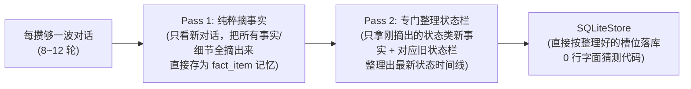
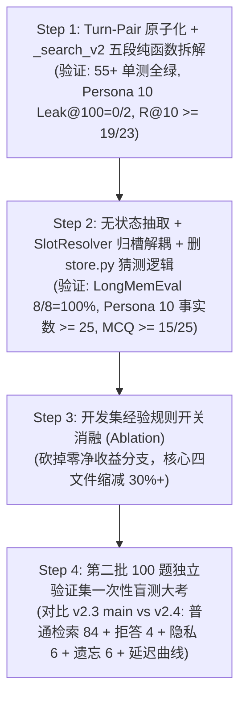

# Dandelion Memory v2.4 架构收敛与解耦设计方案

> **版本定位**：基于 `main`（`374be13`）实测归因、[complexity-review.md](file:///home/maomao/dandelion-memory-batch2-20261026/docs/reports/2026-10-26/complexity-review.md) 复杂度诊断，以及 **砚（4a）**、**烬（Codex `gpt-6-astra`）**、**DeepSeek（`deepseek-v4.1-flash`）** 三方会诊结论制定。核心目标是**消除跨层重复猜测、解耦抽取与归槽、统一问答对原子粒度、用消融实验给代码做减法**。

---

## 一、设计目标与四大架构不变量

### 1.1 量化收敛目标

| 维度 | 当前 `main` (`374be13`) | **v2.4 目标** | 核心手段 |
| :--- | :---: | :---: | :--- |
| **LongMemEval `knowledge-update` (8 题)** | **8/8 (100.0%)** | **8/8 (100.0%)** | 保留 `#F` 多值子槽 + Rank #2 `【状态时间线】` 聚合卡 |
| **PersonaMem 50 题 `ask_to_forget` 零泄漏** | **50/50 (100.0%)** | **50/50 (100.0%)** | 保留显式遗忘硬门控 + 切片级 `[已擦除]` |
| **Persona 10 `Forget Leak@100` (2 题)** | 1/2（放开 AI 邻居后漏出复述） | **0/2 (零泄漏)** | `turn_pair_id` 问答对遗忘级联 + 装箱前终审守门 |
| **Persona 10 活跃 `fact_item` 数 (161 轮)** | 22 条 | **>= 25 条**（对齐 v2.2 的 26 条） | 取消向 Prompt 注入历史账本，恢复无状态高密度抽取 |
| **Persona 10 检索 `R@10` / 端到端 MCQ** | 18/23 (78.3%) / 12/25 (48.0%) | **>= 19/23 (82.6%) / >= 15/25 (60.0%)** | `Turn-Pair` 合并释放 Top-10 重复坑位 + 抽取密度恢复 |
| **静态复杂度（核心四文件）** | 4,888 行（`_search_v2` 833 行） | **缩减 30%+**（`_search_v2` < 250 行） | 删净 `store.py` 猜槽分支，`_search_v2` 拆为 5 个纯函数 |

### 1.2 四大架构不变量（Invariants）

> [!IMPORTANT]
> 1. **INV-1（更新 ≠ 销毁）**：只有包含显式遗忘意图（`has_explicit_forget_keyword`）的指令才能将 `fact_item` 或 `raw_slice` 标为 `tombstoned = 1`。状态演进（Supersede）只更新 `tag_timelines` 并通过置顶的 `【状态时间线】` 卡片呈现，**永不墓碑历史 `fact_item`、永不涂改原始母消息正文**。
> 2. **INV-2（摘取与状态栏整理拆成两次独立调用）**：第一次调用（Pass 1）只看新对话、无状态高密度摘取原子事实（不塞旧状态表，确保日常细节不漏）；第二次调用（Pass 2）仅针对抽出的新事实，结合相关类目的旧状态栏做一次专门的状态整理更新。彻底删掉 `store.py` 里靠字面重叠猜槽位的 180 行规则。
> 3. **INV-3（有边界的 Turn-Pair 问答绑定）**：仅在同一会话内紧挨着的短问答（`user #m -> assistant #m+1`）之间绑定 `turn_pair_id`；跨会话、连续用户发言、超长文档切片或 `assistant_draft` 草稿绝不强行合卡；显式遗忘只按 `user (#m) -> assistant (#m+1)` 单向连带遮蔽 AI 的复述。
> 4. **INV-4（身份单次解释 + 检索纯函数链）**：人物归属（`subject` / `source_tier`）只在写入边界解释一次，检索期只读结构化字段；`_search_v2` 拆解为无共享可变字典的 5 段纯函数链，并在预算装箱前执行最终遗忘防漏检查。

---

## 二、模块一：两步式独立调用（Pass 1 只管摘事实 + Pass 2 专门整理状态栏）

### 2.1 病根与两步拆分设计

在 v2.3 中，为了省一次调用，把历史状态表 `[#F1..#Fn]` 全塞进同一个 Prompt，让 `qwen3.5-flash` 一边摘日常细节、一边算状态增删改（`set/add/delete`）。结果小模型顾此失彼（Persona 10 提取量从 26 条掉到 22 条，还把日常新进展误判成覆盖旧状态）；同时逼着 [store.py](file:///home/maomao/dandelion-memory/src/dandelion_memory/store.py) 写了 180 多行靠字面重叠猜槽位的笨规则。

v2.4 直接把“摘事实”和“更状态栏”拆成**两次清爽、职责单一的模型调用**：



### 2.2 Pass 1：纯粹摘取事实（只管摘，不看旧账）

Pass 1 的 Prompt 完全不塞历史状态表，只看这几轮对话，把所有事实细节和明确遗忘指令摘出来，全部直接存为独立的 `fact_item`（谁也不覆盖谁）：

```json
{
  "facts": [
    {
      "seq": 2,
      "subject": "user",
      "tag": "资产/物品与车辆",
      "value": "拥有 Wells Fargo 提供的 $400,000 房贷预批额度",
      "is_state_candidate": true,
      "source_tier": "user_direct"
    }
  ],
  "forget_actions": [
    {
      "trigger_seq": 15,
      "target_keywords": ["银行卡", "6688"],
      "target_description": "尾号 6688 的银行卡",
      "batch_seqs_to_tombstone": [12, 15]
    }
  ]
}
```

### 2.3 Pass 2：每 20 轮问答（40 条消息）专门总结/更新一次状态栏

把状态栏更新固定为**每 20 轮一问一答（40 条消息，约攒下 3~4 批摘取、6~10 条新事实）触发一次**（若对话结束或发起检索时还有未汇总的新事实，则顺手刷一次兜底）：
- **输入**：只给模型看【这 20 轮里新摘出的事实】+【数据库里同标签下的旧状态栏 `#F1, #F2...`】；
- **任务**：专门判断这些新事实是“更新了某个旧状态槽位（比如搬家、换工作、藏品数量增加）”，还是“新增了一项并列资产/状态（新开 `#Fn`）”，还是“普通日常细节不用进状态栏”；
- **收益**：
  1. Pass 1（每 6 轮问答一次）不受旧状态干扰，日常细节一条不漏；
  2. Pass 2（每 20 轮问答一次）只对比短短几条提炼好的句子，跨十几轮的连续变化也能放在一起看清，80 轮长对话全程只需调 4 次；
  3. [store.py](file:///home/maomao/dandelion-memory/src/dandelion_memory/store.py) 里那 **180 多行靠词面重叠率猜槽位的脏代码全部删光**。

---

## 三、模块二：有边界的 `turn_pair_id` 问答对绑定

### 3.1 什么时候绑、什么时候绝不绑？

把“用户说一句 + AI 回一句”绑成一对（`turn_pair_id`），只针对**同一会话里紧挨着的常规一问一答**。以下 4 种情况**绝不硬绑**：

1. **跨会话或非一问一答不绑**：
   - 用户连发多条消息（`user -> user`）、双人聊天（如 LoCoMo）、或者跨了不同 `session_id` 时，每条消息各自独立，不绑在一起。
2. **超长回复 / 长文档切片不合卡**：
   - 当用户贴了长文或 AI 输出了长篇方案/故事（被切成了多段 `raw_slice`，或单条超过 `1000` 字）时，检索时不把整篇长文和提问硬塞进同一张大卡片，避免一张卡吃光字数预算。
3. **AI 拟稿（`assistant_draft`）不与用户事实混绑**：
   - 当 AI 只是在帮用户写信、润色文案（`source_tier == "assistant_draft"`）时，不跟用户的个人真实经历混成同级卡片。
4. **遗忘连带只走“用户 -> AI”单向**：
   - 只有当用户在 `#m` 说了某件隐私事（后要求忘掉），才顺带遮蔽紧接着回答他的 `AI 回复 #m+1`（防止 AI 顺嘴复述的半句漏底）；反过来绝不会因为删某句 AI 的话而连坐删掉前后用户的正常提问。

### 3.2 检索期：合格短问答合为一张卡（省下 Top-10 坑位）

对满足绑定条件的常规短问答（如 Persona 10 里的 `#40 user` 和 `#41 assistant`）：
- 当两条都被检索召回或互为配对上下文时，合并为**唯一一张 `TurnPairCard`**（`rrf_norm = max(rrf_user, rrf_assistant)`），按顺序展示 `[#m | user] ... \n [#m+1 | assistant] ...`；
- 同一个回合在 Top-10 里只占 **1 个名额**，不再成双成对挤走排名第 10 的关键证据。

### 3.3 遗忘期：单向连带遮蔽 AI 复述（封死 `Leak@100 = 0/2`）

1. **写入遗忘连带**：在 [store.py](file:///home/maomao/dandelion-memory/src/dandelion_memory/store.py) 的 `execute_forget_action` 中，当用户消息 `#m` 被判定为需要遗忘时，自动检查同一问答对的 `AI 回复 #m+1`：对其中包含遗忘关键词的句子打上 `[已擦除]`，若 `#m` 整条被删，则禁止 `#m+1` 作为邻居被别的卡片顺带捞出。
2. **装箱前终审**：在检索结果打包输出前，统一拦截任何已被标记遗忘的问答对残余片段。

---

## 四、模块三：`_search_v2` 的 5 段正交纯函数拆解与减法清单

### 4.1 拆解 833 行的 `_search_v2`（[pipeline.py](file:///home/maomao/dandelion-memory/src/dandelion_memory/pipeline.py)）

将 `_search_v2` 重构为 5 个输入输出显式类型化的正交函数，主控函数控制在 **60 行以内**，总检索代码控制在 **250 行以内**：

| 阶段函数 | 输入 | 输出 | 单一职责 |
| :--- | :--- | :--- | :--- |
| **1. `recall_raw_and_facts`** | `SearchRequest`, `query_vec` | `RecalledPool` | 执行 Vector + BM25 + Time 三路召回，计算基础 `rrf_norm` |
| **2. `pull_timeline_evidence`** | `RecalledPool`, `timeline_pull_map` | `RecalledPool` | 顺着高分 `timeline_summary` 的 `latest_seq` 拉取对应原话切片 |
| **3. `build_turn_pair_cards`** | `RecalledPool`, `store` | `list[TurnPairCard]` | 按 `(turn_pair_id, source_tier, subject)` 聚合并组装问答卡与提炼事实 |
| **4. `score_and_rerank_cards`** | `pure_query`, `list[TurnPairCard]` | `list[ScoredCard]` | 调用 `qwen3-rerank` 计算线性融合分与结构化 `subject` 匹配门控 |
| **5. `pack_with_forget_guard`** | `list[ScoredCard]`, `top_k`, `budget` | `list[SearchItem]` | Rank #2 置顶合格 `timeline_summary`、执行 Token 预算装箱与遗忘终审 |

### 4.2 复杂度减法清单（Direct Removal vs. Ablation）

1. **直接删除的冗余分支**：
   - 删除 [store.py](file:///home/maomao/dandelion-memory/src/dandelion_memory/store.py) 中 `upsert_tag_timeline` 的 180+ 行类目前缀表、词面重叠猜测与动态 DF 停用词逻辑；
   - 删除 [pipeline.py](file:///home/maomao/dandelion-memory/src/dandelion_memory/pipeline.py) 中 `_is_subj_in_query` 的亲属词单字猜测分支，改为直接匹配入库时的结构化 `subject`；
   - 删除 `_search_v2` 中散落的 `long_doc_slice_counts`、`emitted_seqs` 跨卡剥离及 `[⚠️ 状态已更新]` 拼接代码。
2. **在开发集上做开关消融（Ablation）的经验参数**：
   - `Index-to-Raw Pull` 阈值（`tl_rrf >= 0.35`, 权重 `0.85`）；
   - `time_bonus (+0.10)` 与 `latest_bonus (+0.05)`；
   - `D_direct / D_draft` 的固定回填配额分支（对比直接按分数排序是否等价或更优）。

---

## 五、四步执行与验证路线（严守第二批 100 题盲测边界）

> [!WARNING]
> **防过拟合铁律（采纳 Codex `gpt-6-astra` 建议）**：`3c1407b` 采集的**第二批 100 题独立验证集**（LongMemEval-S 40 题 + PersonaMem-v2 30 题 + LoCoMo 30 题）严禁在 Step 1~3 的开发和规则消融中偷看调参，必须留到 **Step 4** 作为一次性盲测验收！



---

## 六、v2.4.1 增量修正：一号总结模型状态融合与合槽同步（Blast Radius 隔离设计）

### 6.1 问题归因

在 v2.4 人物状态 Map 与 `slot_id` 唯一主键重构后，第一批小验证集复测显示：
- **Persona 10**：`R@10 = 22/23 (95.7%)`，`Forget Leak@100 = 0/2`，`MCQ = 19/25 (76.0%)`（他人归属混淆从 6 题降至 0 题）；
- **LongMemEval `knowledge-update` (8 题)**：从 `8/8 (100%)` 降至 `5/8 (62.5%)`（失败题：`da6234e4` 慈善 5K PB 隐式刷新、`b6036f5d` 房贷预批额度变更、`885f10d3` 自行车数量从 3 辆增至 4 辆）。

逐题排查确认，掉分完全是因为在精简代码和切换 `slot_id` 时**误删或漏接了原本在一号总结模型与状态栏同步链路上的 3 项功能**：
1. **`_STATE_SUMMARY_PROMPT` 缺少「前后状态融合与隐式刷新」指令**：Pass 1 精简 Prompt 时移除了隐式状态刷新说明，但一号总结模型（`_STATE_SUMMARY_PROMPT`）只要求输出 `latest_state`，未要求将 `older_fid` 的背景实体/旧基准值与 `newer_fid` 的新进展融合为完整结论句，导致总结模型直接照抄后半句半截原话（如丢了 `charity 5K run` 主语、漏了 `27:12 -> 25:50` 的旧值对照）。
2. **`merge_timeline_slots` 合槽后未将融合后的 `latest_state` 同步回存活槽位的 `fact_item`**：`store.py:1551-1570` 合槽时只更新了 `timeline_summary` 卡片，而存活槽位 `surviving_slot_id` 关联的 `fact_item` 仍停留在未融合的半截原话，导致原始对话卡下方的 `[提炼事实: ...]` 与状态栏不一致。
3. **`get_latest_tag_map` 与 `get_superseded_seqs_map` 漏接细粒度 `slot_id`**：
   - `store.py:2583` 的 `get_latest_tag_map` 仍按粗粒度 `(subject, tag)` 18 个大类互相覆盖（例如同属 `兴趣/运动与休闲活动` 的后续网球比赛对话，把前面慈善 5K 跑步与自行车数量的 `is_latest_in_tag` 顶掉了）；
   - `store.py:2600` 已写好的 `get_superseded_seqs_map(user_id)` 在 `_build_turn_pair_cards` 拆分时被误删调用，导致已被合槽取代的旧对话卡（如 `#3` 旧额度 `$350,000`、`#2` 旧数量 `3 bikes`）缺少 `[状态更新提示: 已于后续 #seq 更新为 ...]` 标注和 `is_superseded` 标记。

### 6.2 修改边界（Blast Radius 隔离契约）

为确保绝不影响已跑通的 Persona 10（`22/23` 召回、`0/2` 遗忘、`19/25` MCQ）及二号认人模型，本次修改严格锁死在以下窄链路内：

| 类别 | 模块 / 函数 | 边界约束 |
| :--- | :--- | :--- |
| **唯一允许修改（In-Scope）** | 1. `extractor.py:26-46` `_STATE_SUMMARY_PROMPT`<br>2. `store.py:1551-1575` `merge_timeline_slots`<br>3. `store.py:2583-2626` `get_latest_tag_map` / `get_superseded_seqs_map`<br>4. `pipeline.py:1305-1706` `_build_turn_pair_cards` 内部状态栏同步与 `is_superseded` 传递 | 仅修改一号总结模型的融合 Prompt、合槽后存活槽位文本同步、以及基于活跃 `slot_id` / `superseded_seqs` 的状态标记。 |
| **严禁触碰（Out-of-Scope）** | - Pass 1 提取器 `_SYSTEM_PROMPT` 与 `extract()`（不破坏提取缓存与密度）<br>- 二号人物消歧模型 `_PERSON_RECONCILE_PROMPT` 与 `apply_person_map_updates()`<br>- 人物门控 `_is_subj_in_query` 与非本人状态卡 `0.35` 降权<br>- `restored_parent` 单卡动态归属头部与 `turn_pair` 组装<br>- 显式遗忘 `execute_forget_action()` 与 Rerank/Pack 分桶 | **以上模块一行代码不改**。 |

### 6.3 精确增量方案

#### 改动点 1：一号总结模型（`_STATE_SUMMARY_PROMPT`）强化「前后状态融合与隐式刷新」
- **输入输出 Schema 不变**：输入仍为同一人物按时间排列的活跃槽位 `[F1] ... [Fn]`，输出仍为 `{"merges": [{"older_fid": "...", "newer_fid": "...", "latest_state": "..."}]}`。
- **Prompt 规则补齐**：
  1. **隐式状态刷新识别**：当 `older_fid` 记录了某项指标的旧纪录/旧数量/旧额度（如 5K PB 为 `27:12`、拥有 `3 bikes`、房贷预批 `$350,000`），而 `newer_fid` 提到该指标已处于新基准（如“正在训练以打破 `25:50` 的 PB”、“带齐全部 `4 bikes` 含新买的 gravel bike”、“拿到 `$400,000` 预批”），必须判定为同一事项的状态更新并合并。
  2. **前后信息完整融合（禁止半截照抄）**：`latest_state` 严禁只复制 `newer_fid` 的片断！必须将 `older_fid` 中的完整背景主语（如赛事名称 `charity 5K run`、银行名称、原有型号明细）与 `newer_fid` 的最新数值融合成一句完整、自洽的最新结论，并显式括号注明旧值演进（如 `"Current personal best time in the charity 5K run is 25:50 (updated from previous PB of 27:12), currently training to beat 25:50"`；`"Currently owns 4 bikes in total (updated from 3 bikes after adding a new gravel bike)"`）。

#### 改动点 2：`merge_timeline_slots` 同步更新存活槽位的 `fact_item`
- 在 `store.py:1551-1572` 执行合槽（`tombstone_slot_id -> surviving_slot_id`）时：
  - 除更新 `kind = 'timeline_summary'` 的 `display_text / search_text / bm25_tokens` 外；
  - 同步将 `surviving_slot_id` 对应的存活 `fact_item`（`WHERE user_id = ? AND kind = 'fact_item' AND (slot_id = ? OR chunk_id = ?) AND tombstoned = 0`）的 `display_text` 更新为融合后的 `resolved_current_state`（若 `surviving_subj.casefold() != "user"`，保持 `【非User本人，系{surviving_subj}的信息】` 前缀与 `[{surviving_subj} | {newer_row['tag']}]` 检索格式一致），并重算其 `search_text` 与 `bm25_tokens`；
  - **严守 `INV-1`**：被合槽取代的 `tombstone_slot_id` 仅墓碑其 `timeline_summary`，其历史 `fact_item` 保持 `tombstoned = 0` 不变（不销毁历史事实，也不涂改母消息 `parent_messages.content`）。

#### 改动点 3：检索卡片组装层恢复细粒度最新判定与旧槽 `[状态更新提示]`
- **细粒度最新轮次判定**：
  - 在 `store.py` 新增 `get_active_slot_latest_seqs(user_id) -> set[tuple[str, int]]`，返回所有活跃槽位（`tombstoned = 0`）的 `(subject_casefold, latest_seq)` 集合；
  - 在 `_build_turn_pair_cards` 中，只要某轮对话 `(subj.casefold(), p_seq)` 属于任一活跃槽位的 `latest_seq`，即具备 `has_active_latest_slot = True`，彻底消除同 `tag` 下不同事项互相覆盖 `latest_seq` 的问题。
- **被合槽取代的旧对话卡追加 `[状态更新提示]`（含同轮混合事实保护）**：
  - 在 `_build_turn_pair_cards` 中调用 `superseded_map = self.store.get_superseded_seqs_map(user_id)`；
  - 当 `group_tier == "user_direct"` 且 `(subj.casefold(), p_seq)` 命中 `superseded_map`（即该轮对话中包含已被一号总结模型明确合槽覆写的旧状态）时：
    1. 在该张对话卡末尾追加去重后的更新提示：`[状态更新提示: 本段提及的旧状态已于后续 #{l_seq} 更新为: {curr_st}]`；
    2. **同轮多事实保护（采纳评审意见）**：仅当该轮不存在任何其它仍处于 `latest_seq` 的活跃槽位（`not has_active_latest_slot`）时，才将 `is_latest_in_tag` 设为 `False` 并标记 `metadata["is_superseded"] = True`（并在 `existing is not None` 聚合分支中保持该标记不被覆盖）；若同轮还包含另一条未过期的独立最新槽位，则保留 `is_latest_in_tag = True`。
  - **零误伤保障**：未发生合槽覆写的绝大多数普通对话卡（如 Persona 10 中未合并的独立日常事实）完全不触发 `superseded_map`，卡片内容、分数与排序一字不变。

